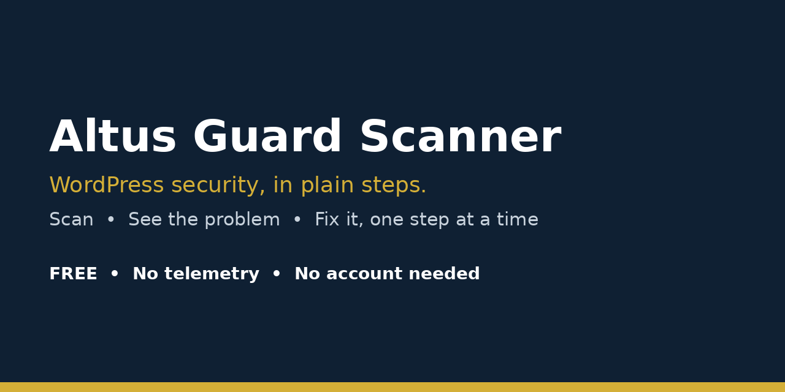

# Altus Guard Scanner — Free WordPress Security Plugin

**Free WordPress security scanner plugin: scan your WordPress site for security problems, see each issue in plain language, and fix it one guided step at a time.**

> **⬇️ Download now:** get the latest release zip from the [**Releases page**](../../releases) → WordPress → Plugins → Add New → Upload Plugin → Install Now → Activate.

**Keywords people search for:** free WordPress security plugin, WordPress security scanner, WordPress malware scanner, WordPress vulnerability scanner, WordPress security audit plugin, WordPress hacked check, lightweight WordPress security plugin, WordPress hardening plugin, WordPress update checker, WordPress PHP files in uploads check.

## Why download Altus Guard Scanner?

Most WordPress security plugins are heavy, paid, or full of jargon. Altus Guard Scanner is different:

- **Free, forever, for the full scan** — no account, no API key, no signup.
- **Lightweight** — one small plugin, no heavy firewall, no site slowdown.
- **Plain-language results** — every finding comes with *one* clear fix step, not a wall of technical warnings.
- **Reports only, never changes your site on its own** — nothing is deleted, edited, or "fixed" without you.

## What this WordPress security scanner checks

| Check | What it finds |
|---|---|
| WordPress core updates | Outdated WordPress core that hackers target first |
| Plugin & theme updates | Plugins and themes with updates waiting |
| PHP version security | Old PHP branches (like PHP 8.1) that no longer get security fixes |
| PHP files in uploads | Suspicious PHP files hiding in the uploads folder — a classic sign of a hacked WordPress site |
| Admin users | Extra or suspicious administrator accounts |
| File editor & debug settings | Dangerous settings left open on a live site |
| Core file integrity (sample) | Changed WordPress core files, checked against WordPress.org checksums |

## Is my WordPress site hacked? Run this check first

If your site is slow, redirecting visitors, showing strange ads, or Google warns about it, run Altus Guard Scanner first. In one click it tells you: outdated core, outdated plugins, old PHP, PHP files in uploads, and unexpected admins — the five most common signs of a hacked WordPress site — plus exactly what to do about each one.

## Install in 2 minutes (free WordPress security plugin download)

1. Download the latest `.zip` from the [**Releases page**](../../releases).
2. WordPress admin → **Plugins → Add New → Upload Plugin** → choose the zip → **Install Now** → **Activate**.
3. Open **Altus Guard** → click **Run Scan Now**.
4. Work through the findings, one step at a time.

No account needed. No settings to configure. The scan also runs automatically once a day, and you get an email **only when a NEW critical finding appears**.

## Who is it for?

- WordPress site owners who want a **free security check** without paying $99+/year
- Small business owners, bloggers, freelancers, and agencies managing client sites
- Anyone asking "is my WordPress site secure?" and wanting an honest answer, not a sales pitch

## What it does NOT do (honest limits)

- It does **not** clean an already-hacked site, and it does **not** guarantee 100% security — no plugin can.
- It does **not** upgrade PHP for you (only your host can do that) and it does **not** yet check a live vulnerability (CVE) database — that is planned for Pro.
- It does **not** send your data anywhere. See Privacy below.

## Privacy: no telemetry, no tracking

- No data leaves your site except: WordPress.org checksums API (core-file sample check) and an email to **your own site admin**, only on new critical findings.
- Results live in one WordPress option, visible to administrators only.
- Every action requires `manage_options` + a valid nonce. No public REST endpoint, no unauthenticated AJAX, no file upload, no custom-PHP-code box, no `eval`.

## Frequently asked questions

**Is Altus Guard Scanner really free?**
Yes. The full scan in this repo is free. A Pro version with a vulnerability feed is planned later — it is not in this release and no payment is taken here.

**Does it slow down my site?**
No. It is a small scanner that runs on demand and once a day via WP-Cron. It has no firewall and no always-on monitoring.

**Do I need an account or API key?**
No. Install, activate, scan. That is it.

**Can it replace Wordfence or Sucuri?**
For a quick, free security audit — yes. For a full firewall + malware removal service — no, those are different (and paid) products. Many site owners use Altus Guard Scanner as their free first check.

**Where can I get support?**
Open an issue in this repo with your WordPress version, PHP version, and the finding you need help with.

## Pro (planned, not active in v1)

A Pro version is planned (CVE/vulnerability feed, more checks, more sites). It is **not** in this release. Prices will be confirmed after vulnerability-feed cost research.

## License

GPLv2 or later.
